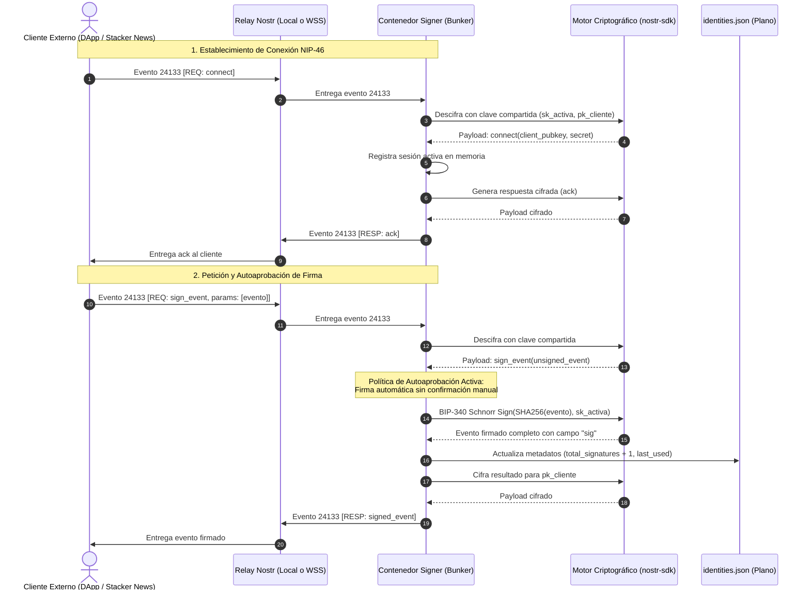
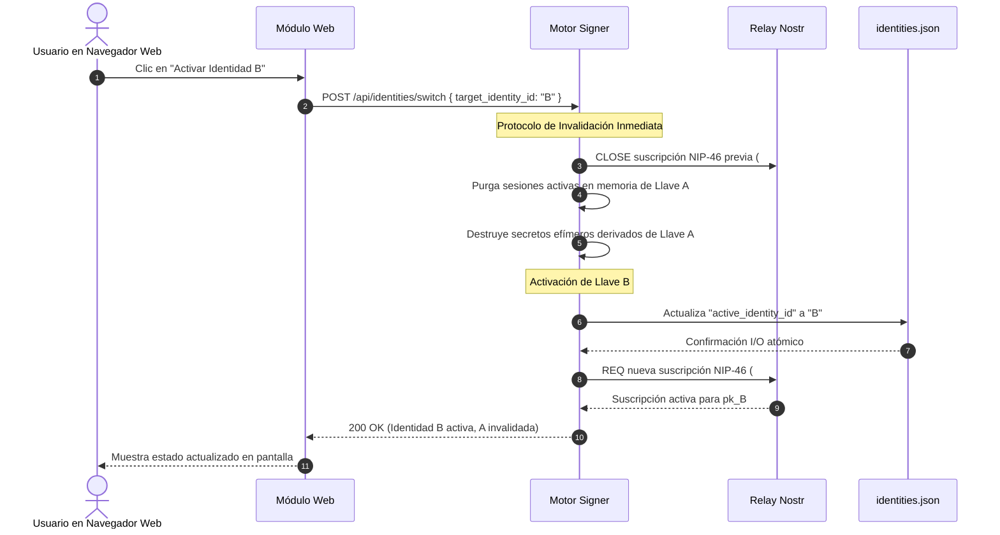

# Especificación Técnica y Funcional Definitiva
## Sistema Local de Identidad y Firmador Remoto Nostr (NIP-46 Bunker)

---

## 1. Visión General y Alcance del Sistema

### 1.1 Objetivo
Definir la arquitectura formal, flujos de datos, modelos Pydantic y contratos de interfaces para una solución local dockerizada de gestión de identidades criptográficas Nostr (`secp256k1` / BIP-340) operando con el rol de **Signer / Bunker remoto (NIP-46)**, comunicándose a través de un **relay Nostr local containerizado (`nostr-rs-relay`)**, con almacenamiento persistente en texto plano y políticas de autoaprobación de firmas.

### 1.2 Parámetros de Diseño Consolidados
1. **Rol Exclusivo:** Signer / Bunker (custodio y ejecutor local de firmas para clientes/endpoints externos).
2. **Métodos NIP-46 Soportados:** Únicamente `connect`, `get_public_key` y `sign_event`.
3. **Flujo de Autorización:** Autoaprobación inmediata de peticiones para sesiones válidas autenticadas.
4. **Ciclo de Vida de Llaves:** Generación local exclusivamente (sin importación ni exportación).
5. **Persistencia:** Archivo estructurado `identities.json` legible por humanos montado en volumen (`./data`), enriquecido con metadatos de auditoría y uso.
6. **Conmutación Estricta:** Al cambiar la identidad activa, todas las sesiones y suscripciones asociadas a la llave anterior son purgadas, cerradas e invalidadas inmediatamente.
7. **Stack Tecnológico:**
   - **Backend:** Python 3.11+ / FastAPI con validación estricta vía Pydantic v2.
   - **Criptografía y Protocolo Nostr:** `nostr-sdk` oficial con llamadas asíncronas (`asyncio`).
   - **Seguridad y Aislamiento:** Confianza en el aislamiento del host local `127.0.0.1` / `localhost`, reforzado mediante `TrustedHostMiddleware`, `CORSMiddleware` y cabeceras de seguridad (`X-Frame-Options: DENY`, `X-Content-Type-Options: nosniff`, `Content-Security-Policy`).
   - **Frontend:** HTML5 semántico, CSS responsivo limpio y JavaScript con jQuery para interactividad, utilizando actualización de datos por demanda (botón de refresco y recarga de estado tras acciones).
   - **Relays Soportados:** Contenedor Docker local de `scsibug/nostr-rs-relay` en puerto `7777` para pruebas locales, con capacidad de conmutación dinámica hacia relays públicos con TLS (`wss://relay.damus.io`, `wss://nos.lol`, etc.) para interoperar con clientes web HTTPS externos como Stacker News.
   - **Puerto Web:** `8000` en `127.0.0.1`.

---

## 2. Arquitectura de Despliegue y Topología Docker

```text
 +---------------------------------------------------------------------------------------+
 | HOST LOCAL (127.0.0.1)                                                                |
 |                                                                                       |
 |   +------------------------------------+         +--------------------------------+   |
 |   | NAVEGADOR DEL USUARIO              |         | CLIENTE / APLICACIÓN EXTERNA   |   |
 |   | http://127.0.0.1:8000 (UI Web)     |         | (DApp / Cliente Nostr)         |   |
 |   +-----------------+------------------+         +---------------+----------------+   |
 |                     |                                            |                    |
 |                     | HTTP REST (On-demand)                      | WebSocket Nostr    |
 |                     v                                            v                    |
 |   +-------------------------------------------------------------------------------+   |
 |   | RED PRIVADA DOCKER (bridge: nostr-net)                                        |   |
 |   |                                                                               |   |
 |   |   +---------------------------------------+   +---------------------------+   |   |
 |   |   | CONTENEDOR 1: local-signer-app        |   | CONTENEDOR 2: local-relay |   |   |
 |   |   | (Python 3.11 + FastAPI + Uvicorn)     |   | (nostr-rs-relay)          |   |   |
 |   |   |                                       |   |                           |   |   |
 |   |   | - Middlewares (TrustedHost/CORS/Sec)  |   | - Servidor WebSocket      |   |   |
 |   |   | - API REST (FastAPI)                  |   |   Nostr NIP-01            |   |   |
 |   |   | - Frontend estático (HTML/CSS/jQuery) |   | - Base de datos local     |   |   |
 |   |   | - Bunker Engine (nostr-sdk / asyncio) |   |   (SQLite en memoria)     |   |   |
 |   |   | - Almacén en plano (identities.json)  |   |                           |   |   |
 |   |   +-------------------+-------------------+   +-------------+-------------+   |   |
 |   |                       |          ^                          ^                 |   |
 |   |                       |          |  ws://local-relay:7777   |                 |   |
 |   |                       |          +--------------------------+                 |   |
 |   +-----------------------|-------------------------------------------------------+   |
 |                           |                                                           |
 |                           v                                                           |
 |   +-------------------------------------------+                                       |
 |   | VOLUMEN PERSISTENTE (Host Bind Mount)     |                                       |
 |   | ./data/identities.json (Texto Plano)      |                                       |
 |   +-------------------------------------------+                                       |
 +---------------------------------------------------------------------------------------+
```

### 2.1 Especificación de Puertos y Servicios
- **`local-signer-app`**:
  - Directiva Docker: `127.0.0.1:8000:8000`
  - URL en el host: `http://localhost:8000` o `http://127.0.0.1:8000`
- **`local-relay`**:
  - Directiva Docker: `127.0.0.1:7777:7777`
  - URL interna en red Docker: `ws://local-relay:7777`
  - URL en el host: `ws://localhost:7777` o `ws://127.0.0.1:7777`

---

## 3. Seguridad y Middlewares de la Aplicación FastAPI

La instancia de FastAPI implementa:

```python
# 1. Restricción estricta de Host a 127.0.0.1 y localhost
app.add_middleware(
    TrustedHostMiddleware, 
    allowed_hosts=["127.0.0.1", "localhost", "127.0.0.1:8000", "localhost:8000"]
)

# 2. CORS restringido al origen local
app.add_middleware(
    CORSMiddleware,
    allow_origins=["http://127.0.0.1:8000", "http://localhost:8000"],
    allow_credentials=True,
    allow_methods=["GET", "POST"],
    allow_headers=["*"],
)

# 3. Security Headers Middleware
# Inyecta:
# - X-Frame-Options: DENY
# - X-Content-Type-Options: nosniff
# - Referrer-Policy: no-referrer
# - Content-Security-Policy: default-src 'self'; script-src 'self' 'unsafe-inline' https://code.jquery.com; style-src 'self' 'unsafe-inline';
```

---

## 4. Modelos de Datos Pydantic (v2) y Formato en Plano

### 4.1 Modelos de Validación
```python
from pydantic import BaseModel, Field
from typing import List, Optional

class IdentityMetadata(BaseModel):
    created_at_utc: str
    created_timestamp: int
    total_signatures_performed: int = 0
    last_used_utc: Optional[str] = None
    last_used_timestamp: Optional[int] = None
    description: Optional[str] = ""

class IdentityKeys(BaseModel):
    private_key_hex: str = Field(..., min_length=64, max_length=64)
    public_key_hex: str = Field(..., min_length=64, max_length=64)
    bech32_nsec: str = Field(..., pattern=r"^nsec1[0-9a-z]+$")
    bech32_npub: str = Field(..., pattern=r"^npub1[0-9a-z]+$")

class IdentityItem(BaseModel):
    id: str
    alias: str
    keys: IdentityKeys
    metadata: IdentityMetadata

class IdentitiesRegistry(BaseModel):
    version: str = "1.0"
    active_identity_id: Optional[str] = None
    identities: List[IdentityItem] = []
```

### 4.2 Formato del Archivo en Plano (`./data/identities.json`)
Guardado con `indent=2` para lectura y edición transparente por parte del usuario:

```json
{
  "version": "1.0",
  "active_identity_id": "id-a89c31b5-6f1e-4c7a-9c44-e2a87b1c4e90",
  "identities": [
    {
      "id": "id-a89c31b5-6f1e-4c7a-9c44-e2a87b1c4e90",
      "alias": "Identidad Principal",
      "keys": {
        "private_key_hex": "e3b0c44298fc1c149afbf4c8996fb92427ae41e4649b934ca495991b7852b855",
        "public_key_hex": "a251b5c20ef69d7a22ef7a2b9101d0cb021e5e6e336d3964d852a4e2a87b1c4e",
        "bech32_nsec": "nsec1...",
        "bech32_npub": "npub1..."
      },
      "metadata": {
        "created_at_utc": "2026-11-06T19:30:00Z",
        "created_timestamp": 1794000600,
        "total_signatures_performed": 15,
        "last_used_utc": "2026-11-06T19:48:00Z",
        "last_used_timestamp": 1794001680,
        "description": "Identidad de desarrollo"
      }
    }
  ]
}
```

---

## 5. Especificación del Protocolo NIP-46 Bunker con `nostr-sdk`

### 5.1 Métodos RPC Soportados y Autoaprobación
El motor del Bunker escucha eventos Nostr `kind: 24133` dirigidos a la clave pública activa:

1. **`connect`**:
   - **Parámetros:** `[<client_pubkey>, <secret_opcional>]`
   - **Acción:** Registra la sesión cliente en memoria y responde con `"ack"`.
2. **`get_public_key`**:
   - **Parámetros:** `[]`
   - **Acción:** Responde con la clave pública activa en formato hexadecimal.
3. **`sign_event`**:
   - **Parámetros:** `[<unsigned_event_json>]`
   - **Acción:**
     1. Deserializa el evento no firmado.
     2. Asigna `pubkey = active_public_key_hex`.
     3. Calcula el ID del evento (SHA-256 según NIP-01).
     4. Genera la firma Schnorr BIP-340 con la clave privada activa.
     5. Ensambla el evento firmado final con el campo `sig`.
     6. **Autoaprobación:** Retorna inmediatamente el evento firmado cifrado para el cliente sin interacción manual.
     7. Incrementa `total_signatures_performed += 1` y actualiza la marca de tiempo de último uso en `identities.json`.

### 5.2 Invalidación Dinámica de Llaves
Cuando se conmuta la identidad activa (`POST /api/identities/switch`):
1. Se cancela la tarea en segundo plano de escucha del relay vinculada a la clave previa.
2. Se purga el diccionario en memoria de sesiones activas y secretos compartidos de la llave anterior.
3. Se actualiza `active_identity_id` en disco.
4. Se inicializa el nuevo cliente `nostr-sdk` vinculado a la nueva clave privada, conectándolo a `ws://local-relay:7777` (o al relay TLS activo) y suscribiéndose a las solicitudes entrantes para la nueva clave pública.

---

## 6. Contratos de la API REST Interna (FastAPI)

- **`GET /api/identities`**
  - **Descripción:** Retorna el listado de identidades y la ID activa con sus metadatos.
  - **Respuesta:** Objeto `IdentitiesRegistry`.

- **`POST /api/identities/generate`**
  - **Descripción:** Genera un nuevo par de llaves criptográficas con CSPRNG y lo persiste en disco.
  - **Request Body:** `{ "alias": "Nombre", "description": "Opcional" }`
  - **Response (201 Created):** Objeto `IdentityItem`.

- **`POST /api/identities/switch`**
  - **Descripción:** Conmuta la identidad activa e invalida de inmediato la anterior.
  - **Request Body:** `{ "target_identity_id": "<id>" }`
  - **Response (200 OK):** `{ "status": "switched", "active_identity_id": "<id>", "invalidated_previous": true }`

- **`GET /api/bunker/status`**
  - **Descripción:** Retorna el estado del Bunker, connection string `bunker://...` y el estado de la conexión al relay.
  - **Response:** Objeto `BunkerStatusResponse`.

- **`POST /api/bunker/relay`**
  - **Descripción:** Actualiza dinámicamente el relay activo (local o público TLS como `wss://relay.damus.io`).
  - **Request Body:** `{ "relay_url": "wss://relay.damus.io" }`
  - **Response (200 OK):** Objeto `BunkerStatusResponse` actualizado.

- **`POST /api/bunker/connect-string`**
  - **Descripción:** Procesa un string `nostrconnect://...` ingresado por el usuario.
  - **Request Body:** `{ "connection_string": "nostrconnect://..." }`

---

## 7. Frontend Local (HTML5 + CSS + jQuery por Demanda)

- **Diseño Limpio y Minimalista:**
  - Panel superior con estado del relay activo (`ws://127.0.0.1:7777` o `wss://...`), identidad activa y botón de actualización manual (refresca contadores y estado).
  - Selector de relay para alternar fácilmente entre el relay local y relays públicos TLS compatibles con aplicaciones HTTPS como Stacker News.
  - Caja de texto para copiar el connection string:
    ```text
    bunker://<pubkey>?relay=ws%3A%2F%2Flocalhost%3A7777
    ```
  - Formulario modal simple para generar una nueva identidad.
  - Tabla interactiva de identidades existentes: alias, npub acortado con botón para copiar, total de firmas realizadas, última fecha de uso y botón para "Activar".
  - Recarga automática de la tabla tras generar o conmutar una llave.

---

## 8. Flujos de Datos Operacionales (Diagramas de Secuencia)

### 8.1 Handshake y Autoaprobación de Firma NIP-46



### 8.2 Conmutación de Identidad con Invalidación Total


